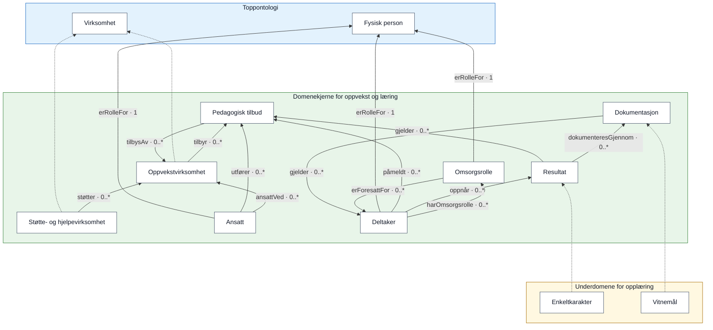
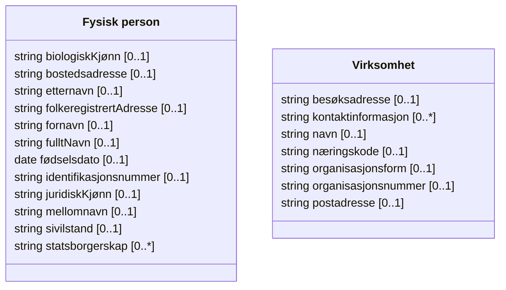
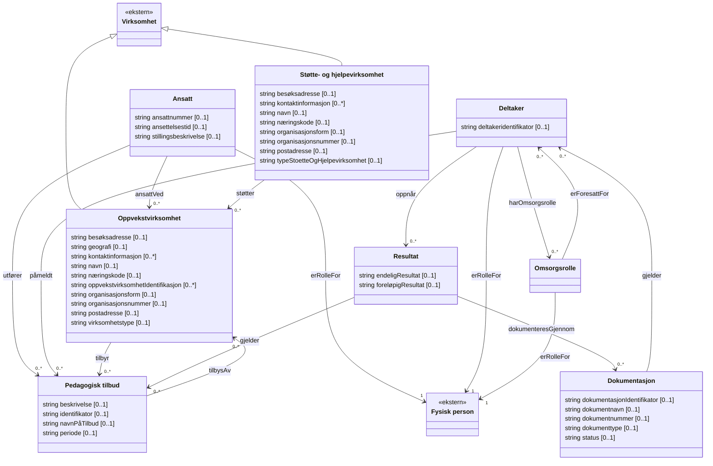
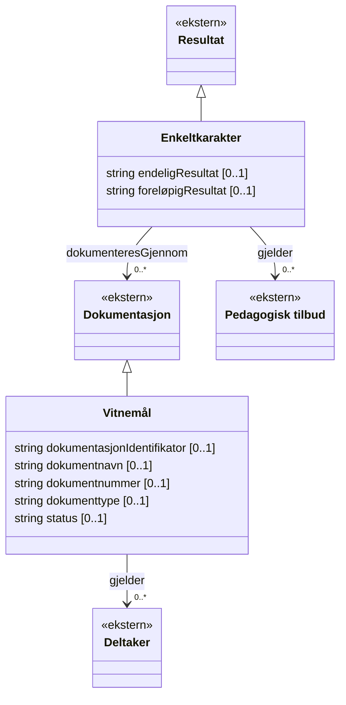

# Oppvekst og læring – informasjonsmodell i tre lag

<!-- Generert fra LinkML-kildene. Se README.md for kommando. -->

Klassene er gruppert etter LinkML-modul.
Stiplede piler peker fra underklasse til overklasse og betyr **arver fra**.
Heltrukne piler viser navngitte relasjoner med kardinalitet ved målet.
Arvede relasjoner vises bare på overklassen.

Diagrammet er generert fra LinkML-modellen og dens importerte moduler.
Banene bruker Mermaid-subgrafer med Dagre-layout og ekstra avstand mellom lagene.

## Klassediagrammer per domene

Hvert diagram viser alle klasser i domenet med egne og arvede datafelt.
Feltene viser datatype og kardinalitet. Relasjoner vises som navngitte piler
med kardinalitet, og trekantpiler peker mot overklassen.
Klasser merket «ekstern» tilhører et annet domene og vises uten felt.

### Toppontologi

### Domenekjerne for oppvekst og læring

### Underdomene for opplæring

