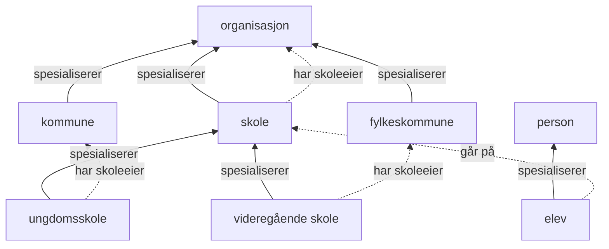

# Begreper i skoledomenet

Heltrukne piler peker fra underbegrep til overbegrep (`xkos:specializes`).
Stiplede piler viser assosiative relasjoner med rollen fra dataene.

Boksene er begreper i samlingen. Generiske begrepsrelasjoner uttrykker
ikke LinkML-arv eller krav til forekomster av skoler.
